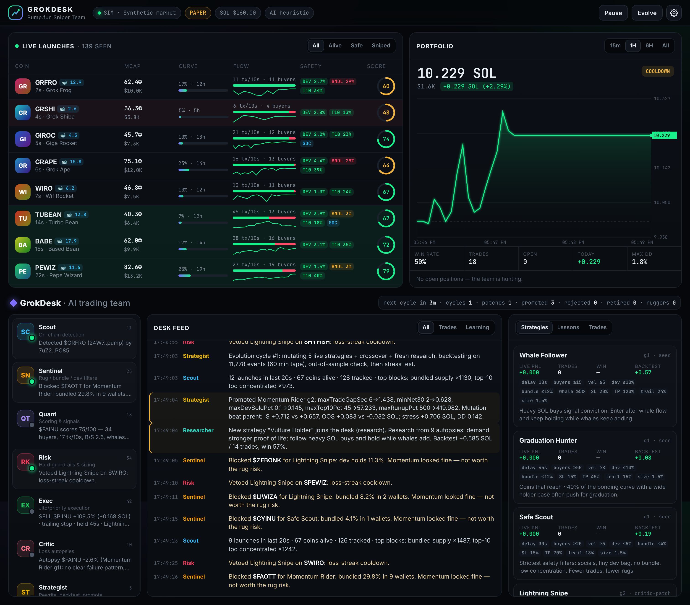

# GrokDesk — Pump.fun Sniper Team (paper trading)

A self-learning AI trading desk that watches every new Pump.fun launch in real time and **paper trades** it. It learns from every loss.

* **Top:** live coin feed and portfolio equity chart.
* **Bottom:** the GrokDesk, eight agents talking in a live desk feed, plus a Lab with strategies, loss autopsies and trades.
* **Web and iPhone:** a responsive website, installable as a PWA, plus a native iOS shell built with Capacitor.

> **Paper only.** No wallet, no private keys, no real orders. The simulator is a stand-in for testing. Simulated profits say nothing about live profits. Real Pump.fun is far more adversarial than any sim.



## The team

| Agent | Job |
|---|---|
| **Scout** | On-chain detection. Gets new launches from PumpPortal's websocket, or directly from Solana `logsSubscribe` on the Pump.fun program (`6EF8…F6P`), decoding Anchor `CreateEvent`/`TradeEvent`/`CompleteEvent`. |
| **Sentinel** | Safety filters: dev bag %, dev already selling, **bundled supply** (same-slot buys at launch), top-10 concentration, socials, and a **serial-rugger blacklist** built from memory. |
| **Quant** | Scores each coin 0–100 on unique buyers, trade velocity, buy/sell SOL ratio, net inflow and whale SOL. Rejects **dead coins** (low tx/10s or a long gap since the last trade). |
| **Risk** | Hard-coded guardrails that no agent or LLM can override. See below. |
| **Exec** | Paper fills on the real bonding-curve math, with latency, failed txs, slippage limits, priority fee and Jito tip. |
| **Critic** | Runs an **autopsy** on every losing trade 90s after the exit (so it can see what happened next): dev rug, bundle dump, dead coin, bought the top, stop too tight, gave back gains, wash pump, falling knife, late fill. Writes `data/<mode>/ledger.md`. |
| **Strategist** | Rewrites a strategy's entry/exit/risk parameters from the Critic's findings, and runs genetic mutation and crossover. **Every change must beat its parent in a backtest on recorded tape, hold up out-of-sample, and survive a stress test** (3× latency, 20% failed txs, higher fees) before it can trade. Live losers are retired. |
| **Researcher** | Designs new strategies from what memory says is killing the desk. With `XAI_API_KEY` (Grok) or `ANTHROPIC_API_KEY` (Claude) it also asks the LLM. LLM output is clamped and backtested like any other idea. |

### Seed strategies
*Lightning Snipe* (seconds after launch, organic flow only) · *Momentum Rider* (wait for proof of life) · *Whale Follower* (enter after heavy SOL buys, **keep holding while whales keep buying**: the trailing stop widens and max hold doubles) · *Graduation Hunter* · *Safe Scout*.

### Hard risk limits (`server/core/risk.js`, frozen)
* ≤ **2% of equity per trade** (and ≤ 2 SOL)
* Every strategy must have a stop-loss ≤ 35%
* ≤ 6 open positions, ≤ 12% total exposure, ≥ 50% cash reserve
* Daily drawdown 10% → halt for the day; total drawdown 25% → kill switch
* 4 losses in a row → 5-minute cooldown; fills more than 20% worse than the signal are rejected

## Run it

```bash
npm install
npm test                 # 18 tests: curve math, filters, risk caps, critic, strategist, decoder, end-to-end learning
npm run train -- 3       # fast-forward: 3 simulated hours of the full learning loop in ~2 minutes
npm run sim              # UI + paper trading on the synthetic market  -> http://localhost:8787
npm run live             # UI + paper trading on the real PumpPortal websocket
FEED_MODE=rpc SOLANA_WS_URL=wss://... npm start   # fastest: direct RPC logsSubscribe (processed commitment)
```

Copy `.env.example` to `.env` to configure. Sim and live keep **separate** memory under `data/sim` and `data/live`, so synthetic lessons never leak into live learning. Live mode records every event to `data/live/tape/*.jsonl`, and the Strategist backtests on that real tape. The longer it runs, the better the backtests get.

**Speed notes:** decisions run in-process in microseconds; the LLM is never in the hot path. For the lowest detection latency use `FEED_MODE=rpc` with a dedicated RPC close to the validators. PumpPortal is the easiest free option.

## iPhone app

**Option A: PWA (no Xcode).** Host the server, open it in Safari, then Share → *Add to Home Screen*. It runs full-screen with a native-style tab bar (Market / Portfolio / Desk / Lab).

**Option B: native app (Capacitor).** You need a Mac with Xcode.
```bash
cd mobile
npm install
GROKDESK_BACKEND=https://your-server.example.com npm run ios:init   # copies web/ and creates ios/
npm run ios:open                                                     # build & run from Xcode
```
The app connects to your GrokDesk server. You can change the backend URL in ⚙ Settings. iOS requires HTTPS for remote servers, so put the server behind TLS (Caddy, Cloudflare Tunnel, ngrok, …). Run `npm run ios:sync` after UI changes.

## Layout

```
server/
  core/      curve.js (bonding curve) · tokenState.js (features) · strategy.js · risk.js · engine.js
  feeds/     pumpportal.js · solanaRpc.js (Anchor event decoder) · services.js (metadata, SOL price)
  agents/    critic.js · strategist.js · llm.js (Grok / Claude)
  learn/     backtest.js · worker.js · memory.js (rugger blacklist, lessons, lineage, ledger.md)
  sim/       market.js (dead / rug / bundle / pump&dump / fader / runner archetypes + sniper bots)
  desk.js    the GrokDesk orchestrator
web/         UI (no build step) · PWA manifest + service worker
mobile/      Capacitor iOS shell
scripts/     train.js · backtest.js · make-icons.js
```

## Going live (not included)
Real execution is intentionally not implemented. If you add it, keep the Risk agent in front of it, start with tiny size, and keep paper and live side by side. Most Pump.fun launches go to zero, and you are competing with thousands of bots.
